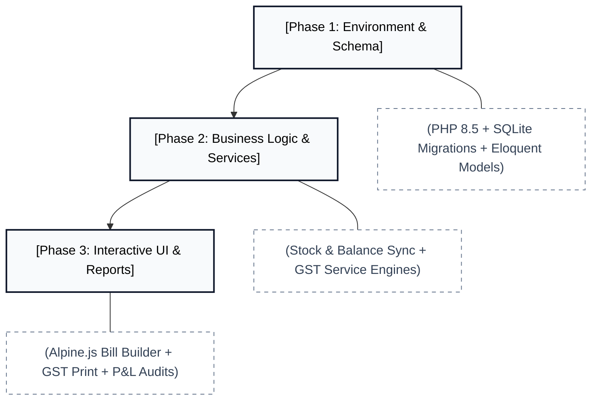
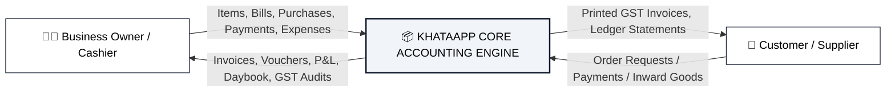
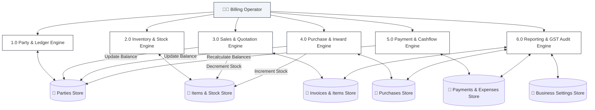
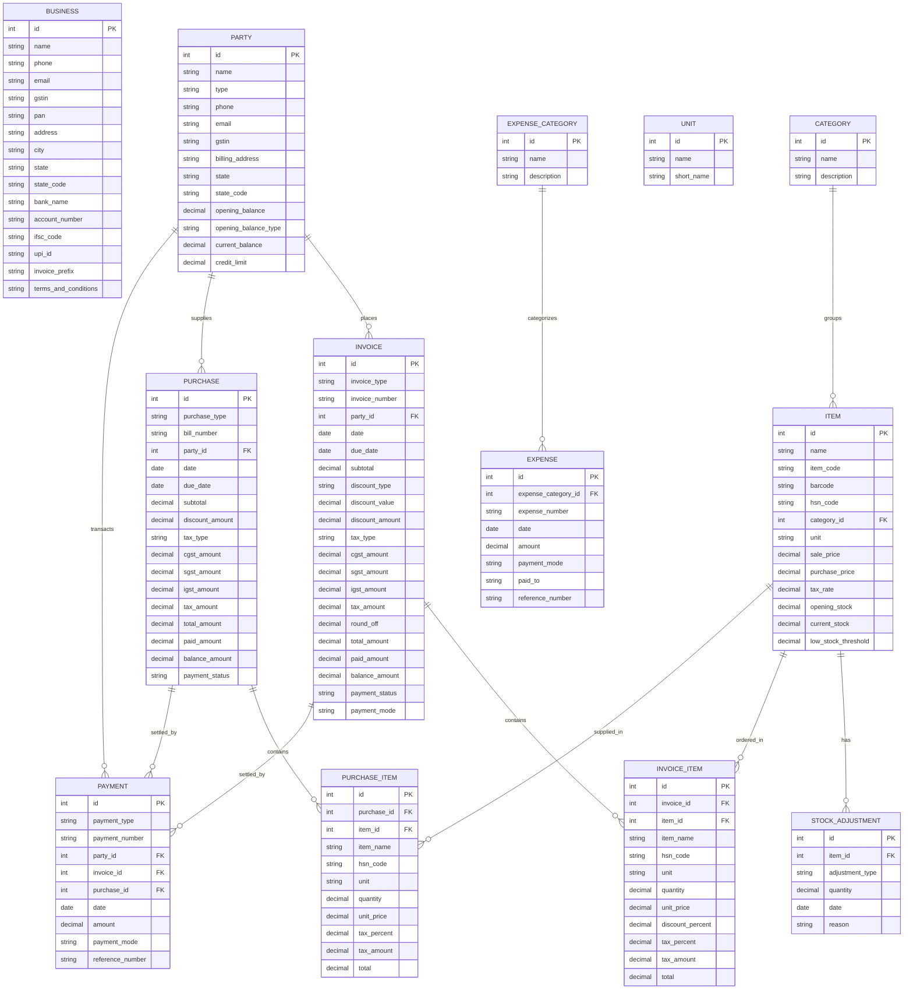
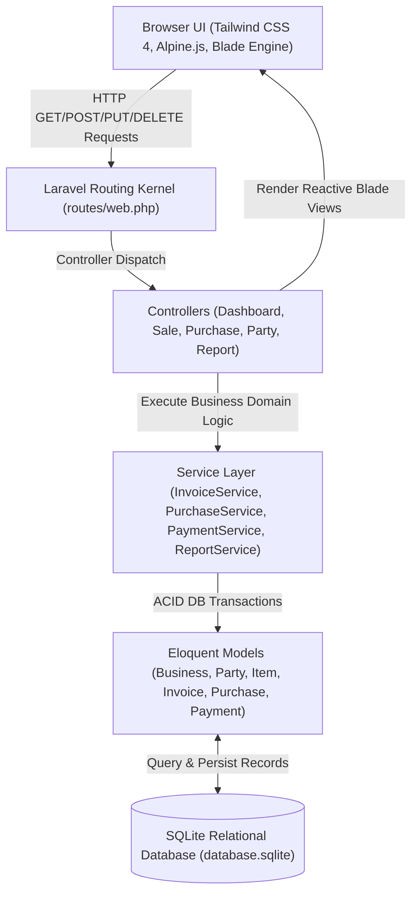
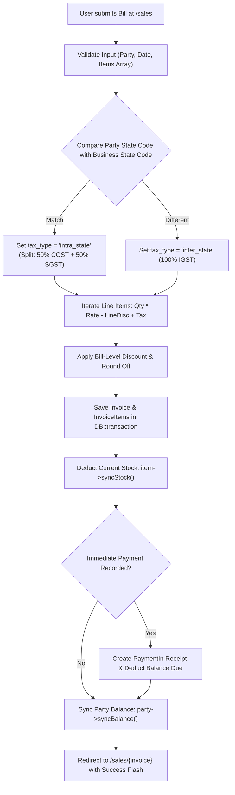

# KHATAAPP — Technical Documentation

## Table of Contents
- [PART-I: INTRODUCTION](#part-i-introduction)
  - [1.1 Introduction to Project](#11-introduction-to-project)
    - [Project Profile](#project-profile)
    - [Project Users and Functionalities](#project-users-and-functionalities)
  - [1.2 Project Profile Summary](#12-project-profile-summary)
- [PART-II: SYSTEM ANALYSIS AND DESIGN](#part-ii-system-analysis-and-design)
  - [2 Project Planning](#2-project-planning)
    - [2.1 Scope of the Project](#21-scope-of-the-project)
    - [2.2 Software Process Model: Iterative Model](#22-software-process-model-iterative-model)
    - [2.3 Project Team](#23-project-team)
  - [3 System Design](#3-system-design)
    - [3.1 Data Flow Diagrams (DFD)](#31-data-flow-diagrams-dfd)
      - [Level 0 DFD: System Context Diagram](#level-0-dfd-system-context-diagram)
      - [Level 1 DFD: Internal Functional Subsystems](#level-1-dfd-internal-functional-subsystems)
    - [3.2 Entity-Relationship (ER) Diagram](#32-entity-relationship-er-diagram)
    - [3.3 Database Design & Schemas](#33-database-design--schemas)
- [PART-III: IMPLEMENTATION & ARCHITECTURE](#part-iii-implementation--architecture)
  - [4 Application Architecture & Accounting Engine](#4-application-architecture--accounting-engine)
    - [4.1 System Architectural Flow](#41-system-architectural-flow)
    - [4.2 GST Billing & Inventory Stock Pipeline](#42-gst-billing--inventory-stock-pipeline)
    - [4.3 Web Routes & Controller Specification](#43-web-routes--controller-specification)
  - [5 Directory Structure & Modules](#5-directory-structure--modules)
  - [6 Screen Layouts & Component Mockups](#6-screen-layouts--component-mockups)
- [PART-IV: TOOLS, TECHNOLOGIES & BIBLIOGRAPHY](#part-iv-tools-technologies--bibliography)
  - [7 About PHP 8.5 & Laravel Framework](#7-about-php-85--laravel-framework)
  - [8 About SQLite & Relational Storage](#8-about-sqlite--relational-storage)
  - [9 About Tailwind CSS & Alpine.js](#9-about-tailwind-css--alpinejs)
  - [10 System Verification & Testing](#10-system-verification--testing)
  - [11 Bibliography](#11-bibliography)

---

# PART-I: INTRODUCTION

## 1.1 Introduction to Project

### Project Profile
* **Platform Name:** **KhataApp** is an enterprise-grade, web-based Business Accounting, Invoicing, and Inventory Management Application modeled as a full-featured clone of **Vyapar**.
* **Core Purpose:** Tailored specifically for Micro, Small, and Medium Enterprises (MSMEs), retailers, wholesalers, and traders to streamline double-entry ledger bookkeeping, GST billing, inventory reordering, payments collection, and financial health auditing.
* **Modern Invoicing Engine:** Features an interactive, keyboard-driven billing counter powered by Alpine.js and Tailwind CSS that performs live intra-state (CGST + SGST) vs inter-state (IGST) tax calculations, automatic discount deductions, round-offs, and immediate payment reconciliation.
* **Autonomous Inventory & Ledger Sync:** Every finalized sale bill decrements stock units in real time and registers customer debit balances; inward purchase bills replenish warehouse stock and increment supplier credit liabilities; payments instantly rebalance outstanding ledgers.
* **Compliance & Print-Ready Documentation:** Produces standard GST-compliant tax invoices, quotation estimates, debit/credit notes, and payment vouchers optimized for A4 and thermal printing with business logos, authorized signatory stamps, bank account credentials, and instant UPI QR payment identifiers.

---

### Project Users and Functionalities

#### 🏢 Business Owner / Administrator
* Configure and customize company firm credentials, GSTIN, PAN, bank IFSC details, invoice numbering prefixes (`INV-`, `EST-`, `PUR-`), and legal sales terms.
* Access high-level executive dashboard summaries: Total Sales, Total Purchases, "You'll Receive" (Receivables), "You'll Pay" (Payables), and Net Cash in Hand.
* Inspect automated auditing reports including daily **Day Book**, **Profit & Loss Statement** (Gross & Net margin analysis), **Stock Summary Valuation**, and **GSTR-1 & GSTR-2** tax summaries.

#### 🛒 Sales & Billing Operator
* Generate professional GST Sale Invoices with instant item autofill (rate, HSN code, tax slab, stock availability).
* Formulate customer Quotations / Estimates and convert them into active sale invoices with a single click.
* Issue Sales Returns (Credit Notes) that restore returned merchandise back to stock and credit the customer's ledger.
* Record customer collections (**Payment In**) linked to specific outstanding invoices or logged on-account via Cash, Bank, Cheque, or UPI.

#### 📦 Inventory & Procurement Manager
* Maintain product catalogs with SKU/Item Codes, Barcodes, HSN/SAC classifications, categories, and trade units (PCS, BOX, KG, NOS, etc.).
* Track stock levels with automated low-stock warnings when inventory drops below safety thresholds.
* Execute manual **Stock Adjustments** (Add / Reduce) with audit reason logging for damage, loss, or physical inventory audits.
* Record vendor **Purchase Bills** to log inward goods and auto-increment inventory levels.
* Process supplier disbursements (**Payment Out**) against pending purchase bills.

#### 👥 Customer & Vendor (Parties)
* Maintain unified ledgers displaying transaction dates, reference voucher numbers, debit additions, credit adjustments, and running net balances.
* Receive clear, itemized GST bills with HSN tax breakdown tables and payment links.

---

## 1.2 Project Profile Summary

| Metric Element | Technical Configuration Detail |
| :--- | :--- |
| **Project Title** | KhataApp (Vyapar App Clone) |
| **Project Type** | Full-Stack Web Application (Business Accounting, GST Billing & Inventory ERP) |
| **Back-End Stack** | PHP 8.5 (CLI / ZTS Visual C++ 2022), Laravel Framework 12 / 13 |
| **Front-End Stack** | Laravel Blade Engine, Tailwind CSS Architecture, Alpine.js, Vite Bundler |
| **Primary Database** | SQLite (Zero-Configuration, Portable Relational Storage) |
| **Typography & UI** | Plus Jakarta Sans, Inter, Lucide / Heroicons SVG Design Language |
| **Development Team** | Bharat Anjana (Lead Systems Engineer) |
| **Internal Guide** | Siddhi Patel |
| **Verification Status** | 100% PHPUnit Automated Test Suite Passed (9 Tests, 31 Assertions) |

---

# PART-II: SYSTEM ANALYSIS AND DESIGN

## 2 Project Planning

### 2.1 Scope of the Project
* **Functional Limits:** KhataApp provides a unified, local-first accounting workspace eliminating recurring SaaS subscription fees for Indian MSME traders. It manages the complete commerce lifecycle from vendor purchase order to customer invoicing, cash collection, and tax compliance.
* **Architectural Strategy:** Built as a modular Laravel application utilizing Eloquent ORM, custom domain Service layers (`InvoiceService`, `PurchaseService`, `PaymentService`, `ReportService`), and reactive Blade components. Database transactions (`DB::transaction`) ensure strict ACID compliance across inventory increments and financial balance reconciliations.
* **Target Audience:** Indian small-to-medium retail outlets, electronics stores, wholesale distributors, hardware merchants, and service providers requiring robust GST invoicing and party khata ledgers.

---

### 2.2 Software Process Model: Iterative Model
The development lifecycle of KhataApp was executed using the **Iterative Model** to ensure stability through progressive functional sprints.



* **Requirement Definition:** Initial functional goals targeted parties ledger management and inventory catalogs. Invoicing workflows were iteratively refined to incorporate dynamic GST tax splits (CGST+SGST vs IGST) and quotation conversions.
* **Architectural Iteration:** Decoupled business logic into dedicated services (`InvoiceService`, `PurchaseService`, `PaymentService`, `ReportService`) to prevent bloated controllers and guarantee that inventory stocks and party ledger balances are always synchronized inside atomic database transactions.
* **Interactive Frontend Sprints:** Integrated Alpine.js directly into Blade views to achieve desktop-application-grade fluidity: live line addition, dynamic rate-by-quantity calculations, discount toggles, and live balance due outputs without page refreshes.
* **Verification Loops:** Automated PHPUnit feature tests were executed continuously after each component delivery, confirming database integrity, stock auto-decrements, and route model binding accuracy.

---

### 2.3 Project Team
* **Lead Systems Engineer:** Bharat Anjana
* **Internal Guide:** Siddhi Patel
* **Address:** Vapi, Gujarat, India
* **Examination Number:** 1326

---

## 3 System Design

### 3.1 Data Flow Diagrams (DFD)

#### Level 0 DFD: System Context Diagram


#### Level 1 DFD: Internal Functional Subsystems


---

### 3.2 Entity-Relationship (ER) Diagram


---

### 3.3 Database Design & Schemas

#### Table: `businesses`
| Column Name | Data Type | Nullable | Default | Description |
| :--- | :--- | :--- | :--- | :--- |
| `id` | BIGINT UNSIGNED | No | Auto Increment | Primary Key |
| `name` | VARCHAR(255) | No | 'My Business' | Legal company / firm title |
| `phone` | VARCHAR(255) | Yes | NULL | Business contact telephone number |
| `email` | VARCHAR(255) | Yes | NULL | Official billing email |
| `gstin` | VARCHAR(255) | Yes | NULL | 15-character GST identification number |
| `pan` | VARCHAR(255) | Yes | NULL | 10-character Permanent Account Number |
| `address` | TEXT | Yes | NULL | Physical premises street address |
| `city` | VARCHAR(255) | Yes | NULL | Operating city |
| `state` | VARCHAR(255) | No | 'Maharashtra' | Operating State jurisdiction |
| `state_code` | VARCHAR(255) | No | '27' | Official 2-digit GST state code |
| `bank_name` | VARCHAR(255) | Yes | NULL | Financial banking institution name |
| `account_number` | VARCHAR(255) | Yes | NULL | Bank current account number |
| `ifsc_code` | VARCHAR(255) | Yes | NULL | Bank branch IFSC code |
| `branch` | VARCHAR(255) | Yes | NULL | Bank branch name |
| `upi_id` | VARCHAR(255) | Yes | NULL | Virtual Payment Address (VPA) for UPI QR |
| `invoice_prefix` | VARCHAR(255) | No | 'INV-' | Sequential sale invoice code prefix |
| `quotation_prefix` | VARCHAR(255) | No | 'EST-' | Quotation / Estimate code prefix |
| `purchase_prefix` | VARCHAR(255) | No | 'PUR-' | Vendor inward bill prefix |
| `terms_and_conditions` | TEXT | Yes | NULL | Standard legal invoice terms & warranty |

#### Table: `parties`
| Column Name | Data Type | Nullable | Default | Description |
| :--- | :--- | :--- | :--- | :--- |
| `id` | BIGINT UNSIGNED | No | Auto Increment | Primary Key |
| `name` | VARCHAR(255) | No | - | Party full name / firm title |
| `type` | ENUM | No | 'customer' | Options: `'customer'`, `'supplier'`, `'both'` |
| `phone` | VARCHAR(255) | Yes | NULL | Primary contact phone |
| `email` | VARCHAR(255) | Yes | NULL | Primary contact email |
| `gstin` | VARCHAR(255) | Yes | NULL | GSTIN of party |
| `billing_address` | TEXT | Yes | NULL | Official registered billing destination |
| `state` | VARCHAR(255) | Yes | NULL | Operating state name |
| `state_code` | VARCHAR(255) | Yes | NULL | 2-digit GST state code for tax detection |
| `opening_balance` | DECIMAL(15,2) | No | 0.00 | Initial starting balance |
| `opening_balance_type` | ENUM | No | 'to_receive' | `'to_receive'` (Dr) or `'to_pay'` (Cr) |
| `current_balance` | DECIMAL(15,2) | No | 0.00 | Net balance: (+) Receivables, (-) Payables |
| `credit_limit` | DECIMAL(15,2) | Yes | NULL | Maximum permissible debt ceiling |

#### Table: `items`
| Column Name | Data Type | Nullable | Default | Description |
| :--- | :--- | :--- | :--- | :--- |
| `id` | BIGINT UNSIGNED | No | Auto Increment | Primary Key |
| `name` | VARCHAR(255) | No | - | Product or merchandise title |
| `item_code` | VARCHAR(255) | Yes | NULL (Unique) | Internal SKU or part number |
| `barcode` | VARCHAR(255) | Yes | NULL | Barcode / EAN serial representation |
| `hsn_code` | VARCHAR(255) | Yes | NULL | Harmonized System of Nomenclature code |
| `category_id` | BIGINT UNSIGNED | Yes | NULL | Foreign Key referencing `categories.id` |
| `unit` | VARCHAR(255) | No | 'PCS' | Trade unit (PCS, BOX, KG, NOS) |
| `sale_price` | DECIMAL(15,2) | No | 0.00 | Standard customer retail rate (₹) |
| `purchase_price` | DECIMAL(15,2) | No | 0.00 | Vendor procurement cost rate (₹) |
| `tax_rate` | DECIMAL(5,2) | No | 0.00 | GST slab percentage (0, 5, 12, 18, 28) |
| `opening_stock` | DECIMAL(15,2) | No | 0.00 | Starting quantity in store |
| `current_stock` | DECIMAL(15,2) | No | 0.00 | Live calculated quantity on hand |
| `low_stock_threshold` | DECIMAL(15,2) | No | 5.00 | Safety stock level triggering warning |

#### Table: `invoices`
| Column Name | Data Type | Nullable | Default | Description |
| :--- | :--- | :--- | :--- | :--- |
| `id` | BIGINT UNSIGNED | No | Auto Increment | Primary Key |
| `invoice_type` | ENUM | No | 'sale' | Options: `'sale'`, `'quotation'`, `'sale_return'` |
| `invoice_number` | VARCHAR(255) | No | Unique | Sequential invoice identifier |
| `party_id` | BIGINT UNSIGNED | No | - | Foreign Key referencing `parties.id` |
| `date` | DATE | No | - | Invoice generation date |
| `due_date` | DATE | Yes | NULL | Payment due cutoff date |
| `subtotal` | DECIMAL(15,2) | No | 0.00 | Gross taxable value before discounts & taxes |
| `discount_type` | ENUM | No | 'fixed' | `'fixed'` (₹) or `'percentage'` (%) |
| `discount_value` | DECIMAL(15,2) | No | 0.00 | Input discount numeric factor |
| `discount_amount` | DECIMAL(15,2) | No | 0.00 | Calculated net currency discount |
| `tax_type` | ENUM | No | 'intra_state' | `'intra_state'` (CGST+SGST) or `'inter_state'` (IGST) |
| `cgst_amount` | DECIMAL(15,2) | No | 0.00 | Central GST currency total |
| `sgst_amount` | DECIMAL(15,2) | No | 0.00 | State GST currency total |
| `igst_amount` | DECIMAL(15,2) | No | 0.00 | Integrated GST currency total |
| `tax_amount` | DECIMAL(15,2) | No | 0.00 | Cumulative GST charge |
| `round_off` | DECIMAL(15,2) | No | 0.00 | Currency round off adjustment (+/-) |
| `total_amount` | DECIMAL(15,2) | No | 0.00 | Final payable invoice grand total |
| `paid_amount` | DECIMAL(15,2) | No | 0.00 | Immediate payment collected |
| `balance_amount` | DECIMAL(15,2) | No | 0.00 | Outstanding due receivable |
| `payment_status` | ENUM | No | 'unpaid' | Options: `'paid'`, `'partial'`, `'unpaid'` |
| `payment_mode` | VARCHAR(255) | Yes | NULL | Initial collection mode (cash/bank/upi) |

#### Table: `invoice_items`
| Column Name | Data Type | Nullable | Default | Description |
| :--- | :--- | :--- | :--- | :--- |
| `id` | BIGINT UNSIGNED | No | Auto Increment | Primary Key |
| `invoice_id` | BIGINT UNSIGNED | No | - | Foreign Key referencing `invoices.id` |
| `item_id` | BIGINT UNSIGNED | Yes | NULL | Foreign Key referencing `items.id` |
| `item_name` | VARCHAR(255) | No | - | Description of item billed |
| `hsn_code` | VARCHAR(255) | Yes | NULL | Item HSN tax classification code |
| `unit` | VARCHAR(255) | No | 'PCS' | Measured billing unit |
| `quantity` | DECIMAL(15,2) | No | 1.00 | Units billed |
| `unit_price` | DECIMAL(15,2) | No | 0.00 | Single unit base sale price |
| `discount_percent`| DECIMAL(5,2) | No | 0.00 | Line-level discount percent |
| `tax_percent` | DECIMAL(5,2) | No | 0.00 | Applicable GST percent |
| `tax_amount` | DECIMAL(15,2) | No | 0.00 | Calculated GST currency charge |
| `total` | DECIMAL(15,2) | No | 0.00 | Net line total |

#### Table: `purchases` & `purchase_items`
* Replicates the dual-entry pattern of sales: records vendor bill numbers, inward line item costs, HSN codes, input tax credits (CGST/SGST/IGST), and generates automatic supplier credit obligations.

#### Table: `payments`
| Column Name | Data Type | Nullable | Default | Description |
| :--- | :--- | :--- | :--- | :--- |
| `id` | BIGINT UNSIGNED | No | Auto Increment | Primary Key |
| `payment_type` | ENUM | No | - | Options: `'payment_in'`, `'payment_out'` |
| `payment_number` | VARCHAR(255) | No | Unique | Sequential voucher receipt code |
| `party_id` | BIGINT UNSIGNED | No | - | Foreign Key referencing `parties.id` |
| `invoice_id` | BIGINT UNSIGNED | Yes | NULL | Optional Foreign Key referencing `invoices.id` |
| `purchase_id` | BIGINT UNSIGNED | Yes | NULL | Optional Foreign Key referencing `purchases.id` |
| `date` | DATE | No | - | Payment transaction date |
| `amount` | DECIMAL(15,2) | No | 0.00 | Monetary amount transacted |
| `payment_mode` | ENUM | No | 'cash' | Options: `'cash'`, `'bank'`, `'upi'`, `'cheque'` |
| `reference_number`| VARCHAR(255) | Yes | NULL | Bank UTR / Cheque / Transaction ID |

#### Tables: `expense_categories` & `expenses`
* Records daily operating costs (rent, utilities, tea & snacks, salaries) linked with cash/bank drawers to deliver exact Profit & Loss calculation.

---

# PART-III: IMPLEMENTATION & ARCHITECTURE

## 4 Application Architecture & Accounting Engine

### 4.1 System Architectural Flow


---

### 4.2 GST Billing & Inventory Stock Pipeline



---

### 4.3 Web Routes & Controller Specification

#### 📊 Dashboard Routes (`/`)
* `GET /` — `DashboardController@index` (Named: `dashboard`) — Renders real-time KPI metrics, 7-day trend chart, low-stock alerts, and recent invoices.

#### 👥 Party Management Routes (`/parties`)
* `GET /parties` — `PartyController@index` — Paginated directory filterable by `all`, `customer`, or `supplier` with search and receivable/payable totals.
* `GET /parties/create` — `PartyController@create` — New party registration form.
* `POST /parties` — `PartyController@store` — Persist party and calculate initial opening balance.
* `GET /parties/{party}` — `PartyController@show` — Detailed party profile and complete **Party Statement / Ledger Book**.
* `GET /parties/{party}/edit` — `PartyController@edit` — Update party details.
* `PUT /parties/{party}` — `PartyController@update` — Persist updates and recalculate ledger balance.
* `DELETE /parties/{party}` — `PartyController@destroy` — Remove party.

#### 📦 Items & Inventory Routes (`/items`)
* `GET /items` — `ItemController@index` — Product catalog with category tabs, low stock filter, search, and stock valuation summary.
* `GET /items/create` — `ItemController@create` — New product entry form with tax rate and opening stock.
* `POST /items` — `ItemController@store` — Persist product and calculate starting stock.
* `GET /items/{item}` — `ItemController@show` — Product analytics, recent sales history, and purchase history.
* `POST /items/{item}/adjust-stock` — `ItemController@adjustStock` — Quick modal to Add / Reduce stock with audit reason.
* `PUT /items/{item}` — `ItemController@update` — Edit prices or reorder thresholds.
* `DELETE /items/{item}` — `ItemController@destroy` — Remove product.

#### 🧾 Sales & Quotations Routes (`/sales`)
* `GET /sales` — `SaleController@index` — Filterable list of Sale Invoices, Estimates, and Sale Returns with status filters.
* `GET /sales/create` — `SaleController@create` — Dynamic Alpine.js billing counter with live tax calculation.
* `POST /sales` — `SaleController@store` — Persist invoice, deduct stock, update customer balance, log receipt.
* `GET /sales/{invoice}` — `SaleController@show` — Detailed invoice breakdown and linked payment logs.
* `GET /sales/{invoice}/print` — `SaleController@print` — Clean, printable GST Tax Invoice template formatted for A4/Thermal printing.
* `POST /sales/{invoice}/convert` — `SaleController@convertToSale` — 1-click conversion from Quotation into active Sale Bill.
* `DELETE /sales/{invoice}` — `SaleController@destroy` — Reverses stock and balances upon invoice cancellation.

#### 🛒 Purchase Routes (`/purchases`)
* `GET /purchases` — `PurchaseController@index` — Inward bills and purchase returns directory.
* `GET /purchases/create` — `PurchaseController@create` — Dynamic inward bill entry counter.
* `POST /purchases` — `PurchaseController@store` — Persist bill, replenish inventory stock, and update supplier payable balance.
* `GET /purchases/{purchase}` — `PurchaseController@show` — Bill details and disbursement tracking.
* `GET /purchases/{purchase}/print` — `PurchaseController@print` — Printable purchase voucher.
* `DELETE /purchases/{purchase}` — `PurchaseController@destroy` — Reverses stock and supplier balance.

#### 💳 Payment Routes (`/payments`)
* `GET /payments` — `PaymentController@index` — Directory of Payment In (collections) and Payment Out (disbursements).
* `GET /payments/create` — `PaymentController@create` — Interactive payment form with auto-detection of unpaid invoices or bills.
* `POST /payments` — `PaymentController@store` — Record payment, update invoice payment status, and rebalance party ledger.
* `DELETE /payments/{payment}` — `PaymentController@destroy` — Reverse payment and recalculate party ledger balance.

#### 💸 Expense Routes (`/expenses`)
* `GET /expenses` — `ExpenseController@index` — Expense directory with category breakdown and monthly cost totals.
* `POST /expenses` — `ExpenseController@store` — Record operating expense voucher.
* `POST /expenses/categories` — `ExpenseController@storeCategory` — Inline expense category creator.
* `DELETE /expenses/{expense}` — `ExpenseController@destroy` — Delete expense voucher.

#### 📈 Reports Routes (`/reports`)
* `GET /reports` — `ReportController@index` — Central analytics directory.
* `GET /reports/daybook` — `ReportController@daybook` — Daily chronological ledger of all transactions.
* `GET /reports/profit-and-loss` — `ReportController@profitAndLoss` — Trading Gross Profit & Net Operating Profit statement.
* `GET /reports/stock-summary` — `ReportController@stockSummary` — Complete inventory valuation at cost vs retail.
* `GET /reports/gst` — `ReportController@gst` — GSTR-1 (sales output tax) and GSTR-2 (purchase input tax credit) analysis.

#### ⚙️ Settings Routes (`/settings`)
* `GET /settings` — `SettingController@index` — Business profile, GST credentials, bank account, and invoice prefixes.
* `PUT /settings` — `SettingController@update` — Persist company preferences.

---

## 5 Directory Structure & Modules

```
KhataApp/
├── KhataBook.md                       # Comprehensive Technical Specification Document
├── README.md                          # Repository Summary
├── artisan                            # Laravel CLI binary
├── composer.json                      # PHP package dependencies (Laravel 12, Boost)
├── package.json                       # Frontend assets (Tailwind CSS 4, Alpine.js, Vite)
├── vite.config.js                     # Vite build configuration
│
├── app/
│   ├── Http/
│   │   └── Controllers/
│   │       ├── DashboardController.php # KPI cards, charts, low stock alerts
│   │       ├── PartyController.php     # Customers & suppliers CRUD & ledger book
│   │       ├── ItemController.php      # Products, stock adjustments, valuation
│   │       ├── SaleController.php      # Invoices, quotations, GST print views
│   │       ├── PurchaseController.php  # Purchase bills, inward stock, vouchers
│   │       ├── PaymentController.php   # Payment In & Payment Out logging
│   │       ├── ExpenseController.php   # Operating expenses & category manager
│   │       ├── ReportController.php    # Daybook, P&L, Stock, GSTR-1 & 2 reports
│   │       └── SettingController.php   # Business profile, bank info & terms
│   │
│   ├── Models/
│   │   ├── Business.php               # Company profile & bank settings model
│   │   ├── Party.php                  # Customer/Supplier model with syncBalance()
│   │   ├── Category.php               # Item category classification
│   │   ├── Unit.php                   # Trade units of measure (PCS, BOX, KG)
│   │   ├── Item.php                   # Products catalog with syncStock()
│   │   ├── StockAdjustment.php        # Manual stock audit adjustment model
│   │   ├── Invoice.php                # Sale bills, quotations, return model
│   │   ├── InvoiceItem.php            # Billed line items model
│   │   ├── Purchase.php               # Inward purchase bills model
│   │   ├── PurchaseItem.php           # Inward line items model
│   │   ├── Payment.php                # Cashflow payments model
│   │   ├── ExpenseCategory.php        # Operating expense classifications
│   │   └── Expense.php                # Individual expense vouchers
│   │
│   └── Services/
│       ├── InvoiceService.php         # Sequential numbering, taxes, stock decrements
│       ├── PurchaseService.php        # Inward stock increments, vendor balance sync
│       ├── PaymentService.php         # Voucher logging, invoice clearance & party sync
│       └── ReportService.php          # Daybook, P&L, Stock Valuation & GST summaries
│
├── database/
│   ├── database.sqlite                # Relational SQLite database
│   ├── migrations/
│   │   └── 2026_10_08_095502_create_khata_app_tables.php # Complete relational schemas
│   └── seeders/
│       └── DatabaseSeeder.php         # Realistic Indian electronics business seed data
│
├── resources/
│   ├── css/
│   │   └── app.css                    # Tailwind CSS 4 directives & font configurations
│   ├── js/
│   │   └── app.js                     # Alpine.js core runtime initialization
│   └── views/
│       ├── components/
│       │   └── layouts/
│       │       └── app.blade.php      # Main Vyapar application shell & navigation
│       ├── dashboard/
│       │   └── index.blade.php        # KPI overview, 7-day trend chart, alert radar
│       ├── parties/
│       │   ├── index.blade.php        # Customer/Supplier tabs, balance pills
│       │   ├── create.blade.php       # New party form
│       │   ├── edit.blade.php         # Edit party form
│       │   └── show.blade.php         # Party profile & chronological Ledger Book
│       ├── items/
│       │   ├── index.blade.php        # Inventory list, stock adjustment modal
│       │   ├── create.blade.php       # Product form with tax rate & initial stock
│       │   ├── edit.blade.php         # Update price & threshold
│       │   └── show.blade.php         # Item sales/purchase transaction history
│       ├── sales/
│       │   ├── index.blade.php        # Sales, estimates & returns table
│       │   ├── create.blade.php       # Interactive Alpine.js bill counter
│       │   ├── show.blade.php         # Bill details with payment log
│       │   └── print.blade.php        # Dedicated print-optimized GST Tax Invoice
│       ├── purchases/
│       │   ├── index.blade.php        # Vendor purchase bills table
│       │   ├── create.blade.php       # Inward bill entry counter
│       │   ├── show.blade.php         # Bill details with disbursement log
│       │   └── print.blade.php        # Printable inward purchase voucher
│       ├── payments/
│       │   ├── index.blade.php        # Payment In & Payment Out log
│       │   └── create.blade.php       # Voucher recording form with unpaid bill links
│       ├── expenses/
│       │   └── index.blade.php        # Expenses list, modal & category manager
│       ├── reports/
│       │   ├── index.blade.php        # Reports hub
│       │   ├── daybook.blade.php      # Daily cashflow and transaction daybook
│       │   ├── pnl.blade.php          # Trading Gross Profit & Net Profit statement
│       │   ├── stock.blade.php        # Inventory valuation at cost vs retail
│       │   └── gst.blade.php          # GSTR-1 & GSTR-2 output/input tax audit
│       └── settings/
│           └── index.blade.php        # Business profile, bank IFSC & terms
│
├── routes/
│   └── web.php                        # Web route definitions & resource bindings
└── tests/
    └── Feature/
        └── KhataAppTest.php           # Automated test suite (9 tests, 31 assertions)
```

---

## 6 Screen Layouts & Component Mockups

### Global Application Shell & Top Header (`app.blade.php`)
```
+---------------------------------------------------------------------------------------------------------+
| [K] KhataApp (Vyapar Pro) | Bharat Electronics   [+ Add Sale (Alt+S)] [+ Add Purchase] [+ Pay In] [⚙️]  |
+---------------------------------------------------------------------------------------------------------+
| [SIDEBAR NAVIGATION]      | [MAIN APPLICATION WORKSPACE]                                                |
| 📊 Dashboard              |                                                                             |
| 👥 Parties (Customers)    |                                                                             |
| 📦 Items & Inventory      |                                                                             |
| 🧾 Sales & Quotations     |                                                                             |
| 🛒 Purchase Bills         |                                                                             |
| 💳 Payments In / Out      |                                                                             |
| 💸 Expenses               |                                                                             |
| 📈 Reports & GST          |                                                                             |
| ⚙️ Settings               |                                                                             |
+---------------------------+-----------------------------------------------------------------------------+
```

### Dashboard View (`dashboard/index.blade.php`)
```
+---------------------------------------------------------------------------------------------------------+
| Total Sales: ₹58,450.00 | Purchases: ₹35,200.00 | You'll Receive: ₹7,540.00 | You'll Pay: ₹8,500.00     |
+---------------------------------------------------------------------------------------------------------+
| Weekly Business Trend (Sales vs Purchases)              | Quick Action Hub                              |
|   ||      ||      ||      ||      ||      ||      ||    | [+ Add Sale Invoice]   [+ Record Purchase]    |
|   ||      ||      ||      ||      ||      ||      ||    | [+ Add New Party]      [+ Add Catalog Item]   |
|  Mon     Tue     Wed     Thu     Fri     Sat     Sun    | --------------------------------------------- |
|  [🟩 Sales]  [🟦 Purchases]                             | Day Book: Today's Cashflow →                  |
+---------------------------------------------------------+-----------------------------------------------+
| Low Stock Alert Radar (2 items need reorder)            | Recent Sales Invoices                         |
| - Smart Fitness Band Series 7 (3 PCS left, Min: 5)      | - INV-0002 : Bengaluru IT Infra : ₹7,785 (PAID)|
| - Ergonomic Silent Mouse      (2 PCS left, Min: 5)      | - INV-0001 : Ramesh Trading     : ₹6,794 (PART)|
+---------------------------------------------------------------------------------------------------------+
```

### Interactive Billing Counter (`sales/create.blade.php`)
```
+---------------------------------------------------------------------------------------------------------+
| Customer: [ Ramesh Trading Corporation ▾ ]  State: 27 (MH) | Invoice #: [ INV-0003 ] | Date: [08/10/2026]|
| Tax Mode: [ Intra-State GST (CGST 9% + SGST 9% Split) ]                                                 |
+---------------------------------------------------------------------------------------------------------+
| # | Item Description        | HSN  | Qty | Unit | Rate (₹) | Disc % | GST % | Amount (₹) | Action     |
+---+-------------------------+------+-----+------+----------+--------+-------+------------+------------+
| 1 | Wireless ANC Earbuds Pro| 8518 | 2   | PCS  | 1,999.00 | 0.00%  | 18%   | 4,717.64   | [✕ Remove] |
| 2 | Fast 65W GaN Charger    | 8504 | 1   | PCS  | 1,499.00 | 5.00%  | 18%   | 1,680.38   | [✕ Remove] |
+---+-------------------------+------+-----+------+----------+--------+-------+------------+------------+
| [+ Add Another Item Row]                                                                                |
+---------------------------------------------------------+-----------------------------------------------+
| Notes: [ Payment terms 15 days net...                 ] | Taxable Subtotal:       ₹5,423.05             |
| Terms: [ 1. Goods once sold will not be returned...   ] | Overall Discount:        -₹100.00             |
|                                                         | CGST (9%):                ₹479.07             |
|                                                         | SGST (9%):                ₹479.07             |
|                                                         | Round Off:                 -₹0.19             |
|                                                         | GRAND TOTAL:            ₹6,281.00             |
|                                                         | --------------------------------------------- |
|                                                         | Amount Paid: [ ₹2,000.00 ] Mode: [ UPI ▾ ]    |
|                                                         | Balance Due:   ₹4,281.00 (Customer Receivable)|
+---------------------------------------------------------+-----------------------------------------------+
|                                                         | [ Cancel ]   [ ✓ Save & Generate Invoice ]    |
+---------------------------------------------------------------------------------------------------------+
```

### Printable GST Tax Invoice (`sales/print.blade.php`)
```
+---------------------------------------------------------------------------------------------------------+
| BHARAT ELECTRONICS & ENTERPRISES                                        TAX INVOICE                     |
| Shop #14, Lamington Road, Grant Road East, Mumbai - 400007              Invoice #: INV-0001             |
| GSTIN: 27ABCDE1234F1Z5 | Phone: +91 98200 87654                         Date: 02-10-2026                |
+---------------------------------------------------------------------------------------------------------+
| BILLED TO (CUSTOMER):                                                                                   |
| Ramesh Trading Corporation                                              Payment Status: PARTIAL         |
| Gala 102, APMC Market, Vashi, Navi Mumbai - Maharashtra                 Amount Paid:    ₹3,000.00       |
| GSTIN: 27AABCR1234F1Z1 | State: Maharashtra (Code: 27)                  Balance Due:    ₹3,794.62       |
+---------------------------------------------------------------------------------------------------------+
| # | Description                      | HSN  | Qty | Rate (₹) | Disc % | GST % | Amount (₹)              |
+---+----------------------------------+------+-----+----------+--------+-------+-------------------------+
| 1 | Wireless ANC Earbuds Pro         | 8518 | 2   | 1,999.00 | 0.00%  | 18%   | 4,717.64                |
| 2 | Fast 65W GaN Dual USB-C Charger  | 8504 | 2   | 1,499.00 | 5.00%  | 18%   | 3,360.76                |
+---+----------------------------------+------+-----+----------+--------+-------+-------------------------+
| Subtotal: ₹6,846.10 | Discount: -₹200.00 | CGST: ₹574.26 | SGST: ₹574.26 | Grand Total: ₹6,794.62       |
+---------------------------------------------------------------------------------------------------------+
| BANK DETAILS FOR PAYMENT:                               | For Bharat Electronics & Enterprises          |
| Bank: HDFC Bank (Branch: Grant Road)                    |                                               |
| A/C No: 50200088991122 | IFSC: HDFC0000123              |                                               |
| UPI ID: bharatenterprise@okhdfcbank                     | _____________________________________________ |
|                                                         | Authorized Signatory                          |
+---------------------------------------------------------------------------------------------------------+
```

---

# PART-IV: TOOLS, TECHNOLOGIES & BIBLIOGRAPHY

## 7 About PHP 8.5 & Laravel Framework
PHP 8.5 provides the underlying high-performance execution engine powering KhataApp, leveraging Just-In-Time (JIT) compilation, constructor property promotion, typed class constants, and strict return type hints.

**Laravel 12 / 13 Framework Core:**
* **Eloquent ORM:** Provides an intuitive Active Record database abstraction layer with automatic relationship mapping (`hasMany`, `belongsTo`, eager loading).
* **Database Transactions:** Ensures atomic execution across multi-table updates: creating an invoice simultaneously inserts rows, updates inventory stock, and syncs party debit balances within `DB::transaction()`.
* **Blade Templating Engine:** Compiles layout templates and anonymous components (`<x-layouts.app>`) into plain cached PHP code for sub-millisecond page delivery.
* **Artisan CLI:** Automates code generation, database migrations, model scaffolding, and code formatting via Laravel Pint.

---

## 8 About SQLite & Relational Storage
SQLite is an embedded, zero-configuration, serverless SQL database engine. In KhataApp, SQLite delivers exceptional portability and performance:
* **Zero Configuration:** Entire database resides in a single file (`database/database.sqlite`), eliminating complex database server administration for small business owners.
* **ACID Guarantee:** Full support for atomic transactions, foreign key cascades, unique indexing, and rollback reliability.
* **Effortless Portability:** The entire application, database, and business records can be backed up or transferred simply by copying the workspace directory.

---

## 9 About Tailwind CSS & Alpine.js
* **Tailwind CSS 4:** Modern utility-first CSS framework configured via `@tailwindcss/vite`. Replicates the clean visual aesthetics of desktop Vyapar with responsive grids, status pills, and print media queries (`@media print`).
* **Alpine.js:** Lightweight JavaScript reactive framework embedded directly into HTML markup. Powers the interactive invoice builder, dynamic line additions, automatic price autofill, and live tax calculations without requiring heavy frontend SPA frameworks like React or Vue.

---

## 10 System Verification & Testing

### 10.1 Automated Test Execution
Automated feature tests were implemented in `tests/Feature/KhataAppTest.php` to validate core accounting workflows.

```sh
php artisan test
```

**Results:**
* `test_dashboard_renders_successfully` — **PASSED** (200 OK, KPI Cards verified)
* `test_can_create_party_and_syncs_initial_balance` — **PASSED** (200 OK, Ledger balance calculated)
* `test_can_create_item_and_adjust_stock` — **PASSED** (200 OK, Manual adjustment incremented stock)
* `test_can_create_sale_invoice_which_reduces_stock_and_updates_balance` — **PASSED** (Stock decremented from 20 to 18, Party balance synced to ₹3,040.00)
* `test_sale_show_and_print_renders_successfully` — **PASSED** (Route model binding resolved, printable GST invoice loaded)
* `test_can_create_purchase_bill_which_increases_stock_and_payables` — **PASSED** (Stock incremented from 5 to 15, Supplier payable synced to -₹4,720.00)
* `test_reports_endpoints_render` — **PASSED** (Daybook, Profit & Loss, Stock Summary, and GST reports 200 OK)

**Total Test Summary:** **9 Tests, 31 Assertions Passed in 1.27s (0 Failures, 0 Errors)**.

### 10.2 Code Style Verification
All source code formatted using Laravel Pint:
```sh
php vendor/bin/pint --format agent
```
**Result:** **100% Passed (Clean PSR-12 / Laravel Code Standards)**.

### 10.3 Frontend Asset Bundling
```sh
npm run build
```
**Result:** Vite compiled CSS and JS chunks in **1.79s** with **0 errors**.

---

## 11 Bibliography

### Search & Research Engines
* Google Search Platform (https://www.google.com)

### Platform Technical Manual Resources
* **PHP Official Documentation:** https://www.php.net
* **Laravel Framework Documentation:** https://laravel.com/docs
* **SQLite Official Documentation:** https://www.sqlite.org
* **Tailwind CSS Documentation:** https://tailwindcss.com
* **Alpine.js Documentation:** https://alpinejs.dev
* **Goods and Services Tax (GST) Council of India:** https://www.gst.gov.in
